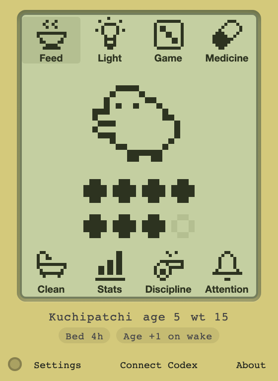
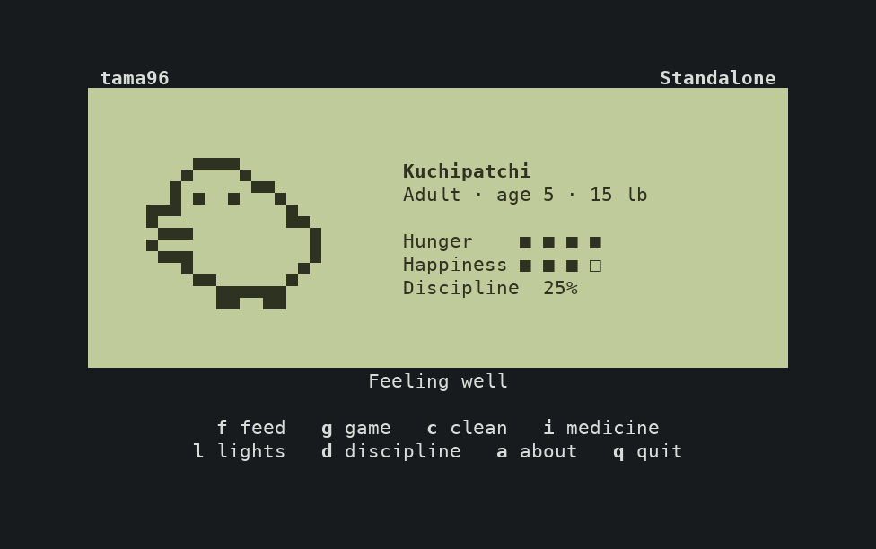

# tama96

A virtual pet inspired by the 1996 Tamagotchi P1. Play on desktop (Tauri + React), in the terminal (ratatui TUI), or let an AI agent care for your pet via the bundled MCP server.

**[Download the latest release](https://github.com/siegerts/tama96/releases)**




## TUI




```
┌──────────────────────────────────────────────────┐
│  Egg → Babytchi → Marutchi → Teen → Adult → …    │
│  Real-time lifecycle: 1 real day = 1 pet year    │
│  Your care choices shape who your pet becomes    │
└──────────────────────────────────────────────────┘
```

## How it works

Your pet lives in real time. Every minute the simulation ticks — hunger and happiness decay, poop accumulates, sickness can set in. One real day equals one pet year. Leave your pet alone too long and it dies. Take good care of it and it evolves into a better character.

The LCD screen has two rows of icons you can click (or tap the keyboard shortcuts in the TUI). Here's what they all do:

### Top row

| Icon | Name | What it does |
|------|------|-------------|
| Steaming bowl | Feed | Opens a submenu: Meal restores 1 hunger heart (+1 weight), Snack restores 1 happiness heart (+2 weight). Can't feed a sick pet. |
| Light bulb | Light | Toggles lights on/off. The desktop info strip shows the next bedtime, and bedtime starts with a lights-off warning. Turn lights off so your pet can sleep. If you leave them on too long after bedtime, you get a care mistake. |
| Die | Game | Pick left or right for five turns. Match three turns for a happiness heart. Finishing a game uses one weight, down to a minimum of one. |
| Capsule | Medicine | Gives one dose of medicine. Takes 2 doses to cure sickness. Only works when the pet is actually sick. |

### Bottom row

| Icon | Name | What it does |
|------|------|-------------|
| Bathtub | Clean | Removes one poop. Poop accumulates over time based on your character's poop interval. 4+ poops makes your pet sick. |
| Bar chart | Stats | Shows current hunger, happiness, and weight. Just an info check, no action. |
| Whistle | Discipline | Scolds your pet when it's acting out. A discipline call appears randomly (~10% chance per tick) with a 15-minute deadline. Miss it and you get a discipline mistake. More discipline = better evolution outcomes. |
| Bell | Attention | Shows what needs your attention right now — bedtime/lights, sickness, poop, or a pending discipline call. Another info-only button. |

Hover over a control or the hearts to see their labels. The upper row shows hunger and the lower row shows happiness. Keyboard focus reveals the same labels.

Each match earns one star when all five turns are complete. Three cumulative stars unlock the pet’s animated 3D form in the desktop Game screen. On macOS, choose **Walk on desktop** after the reveal to send the pet out of the handheld. It walks over other windows and lets clicks pass through. Choose **Bring home** on the LCD or **Bring Pet Home** in the menu bar to call it back. Stars, the best five-turn score, and unfinished rounds are saved with the pet and shared by the desktop and TUI. The homepage offers a feeding demo and a free preview of Kuchipatchi’s 3D form.


### Meters and hearts

- Hunger and happiness each have 4 hearts. They decay over time at rates that depend on your character (harder characters decay faster).
- When either meter hits 0, a 15-minute care deadline starts. Miss it = care mistake.
- Discipline is a percentage (0–100%). Goes up by 25% each time you successfully discipline.

### Sickness

Your pet gets sick from:
- Too much poop (4+ poops)
- Overfeeding snacks as a baby (3+ snacks)

A sick pet can't eat or play. Give 2 doses of medicine to cure it. Leave it untreated too long and it dies.

### Death

Your pet can die from:
- Old age (each character has a max lifespan)
- Neglect (hunger AND happiness at 0 for 12+ hours)
- Untreated sickness
- Baby snack overfeeding (5+ snacks)

When your pet dies, you can hatch a new egg from the death screen.

### Sleep

Each character has a bedtime and wake time. When bedtime hits:
1. If lights are on, you get a 15-minute window to turn them off
2. Once lights are off, the pet sleeps (no decay, no actions)
3. At wake time, the pet wakes up and age increments by 1
4. The desktop app now shows a bedtime countdown plus active lights deadlines in the info strip, and the TUI shows `BEDTIME` in the status/help line when lights need attention

That wake-time age increase is what moves your pet toward later stages. If the pet never gets to sleep, it never gets the next wake-up age tick.

## Evolution

How you care for your pet determines what it becomes. Care mistakes and discipline mistakes during each stage feed into the evolution matrix:

```
Egg ──(5min)──► Babytchi ──(65min)──► Marutchi ──(age 3)──► Teen ──(age 6)──► Adult

Teen selection:
  care_mistakes 0–2 → Tamatchi
  care_mistakes 3+  → Kuchitamatchi
  discipline_mistakes 0–2 → Type1
  discipline_mistakes 3+  → Type2

Adult selection (full P1 matrix):
  Tamatchi T1 + good care → Mametchi (best)
  Tamatchi T1 + ok care   → Ginjirotchi
  Tamatchi T1 + poor care → Maskutchi / Kuchipatchi / Nyorotchi / Tarakotchi
  Kuchitamatchi path      → Kuchipatchi / Nyorotchi / Tarakotchi

Special: Maskutchi (from Tamatchi T2 path) ──(4 days)──► Oyajitchi
```

## Architecture

```
tama-core/          Shared Rust library — game engine, state, evolution, persistence
tama-tauri/         Tauri v2 desktop app (system tray, background ticks, notifications)
  src-tauri/          Rust backend (IPC commands, TCP socket, sidecar management)
  ui/                 React frontend (LCD canvas, clickable icons, permissions panel)
tama-tui/           Terminal app — ratatui with pixel sprites and keyboard controls
mcp-server/         Node.js MCP sidecar — exposes pet to AI agents via stdio
```

All frontends share `tama-core` for game logic. A lockfile at `~/.tama96/tama96.lock` ensures only one process owns the simulation at a time. State persists to `~/.tama96/state.json` with elapsed-time catch-up on load.

The TUI can run alongside the desktop app in client mode — it reads state from disk and sends actions over TCP instead of owning the simulation directly. A status line at the bottom tells you which mode you're in.

## Prerequisites

- Rust (edition 2024, stable toolchain)
- Node.js >= 18
- Tauri v2 system dependencies: https://v2.tauri.app/start/prerequisites/
- Tauri CLI: `cargo install tauri-cli --version "^2"`

## Getting started

### Tests

```bash
cargo test -p tama-core
```

### Desktop app (Tauri)

```bash
npm --prefix mcp-server ci
npm --prefix mcp-server run build
npm --prefix tama-tauri/ui ci
cd tama-tauri && npx @tauri-apps/cli dev
```

The app lives in the system tray when you close the window. Your pet keeps ticking in the background. Notifications fire on hunger/happiness hitting zero, evolution, and death.

Click the LCD icons directly to interact. Hover for tooltips. The info line below the LCD shows your pet's name, age, and weight, plus sleep cues like the next bedtime or an active lights-off deadline. Hover it for detailed timing info (bedtime, wake/age reminder, next hunger drop, next poop, evolution countdown).

### Terminal app (TUI)

```bash
cargo run -p tama-tui
```

To use the desktop app, TUI, and an MCP client together, start the desktop app first. It runs the simulation. The TUI enters client mode, reloads the same pet once a second, and sends care actions to the desktop app. Connect your MCP client with the generated config below. Both clients use the desktop app’s agent permissions. If the TUI is already in standalone mode, quit it with `q`, start the desktop app, and reopen the TUI.

When bedtime starts, the TUI status area shows `BEDTIME` so you know to press `l`.

| Key | Action |
|-----|--------|
| `f` | Feed (then `m` for meal, `s` for snack) |
| `g` | Open the guessing game. Use ← or → to guess, Esc to pause, and Enter to play again after the score. |
| `d` | Discipline |
| `c` | Clean poop |
| `l` | Toggle lights |
| `i` | Give medicine |
| `q` | Quit |

### MCP server

Open **Connect Codex → Add to Codex** in the desktop app. This registers the bundled server with the local Codex CLI and verifies its saved entry. Setup requires Node.js 18 or newer. Keep the app running, open a new Codex chat, and ask “How is my tama96 pet doing?”

If the Codex CLI is unavailable, **Manual setup → Copy TOML** gives you a section to add to your Codex `config.toml`. **Other clients → Copy JSON** gives you the corresponding server entry for JSON-based clients. The app also saves this JSON in `~/.tama96/mcp_config.json`. Merge the entry into your existing configuration. For Claude Desktop on macOS, use `~/Library/Application Support/Claude/claude_desktop_config.json`.

The config looks like this (paths are filled in automatically):

```json
{
  "mcpServers": {
    "tama96": {
      "command": "node",
      "args": ["/path/to/index.js"]
    }
  }
}
```

The MCP server needs the desktop app running (it communicates over a local TCP socket). The port is written to `~/.tama96/mcp_port` on startup.

Tools: `feed`, `play_game`, `discipline`, `give_medicine`, `clean_poop`, `toggle_lights`, `get_status`

Resources: `pet://status`, `pet://evolution-chart`, `pet://permissions`

For development/standalone testing:

```bash
cd mcp-server && npm install && npm run build && npm start
```

## Agent permissions

AI agents are gated by a permission system you control:

- Master kill switch (enable/disable all agent access)
- Per-action allow/deny toggles
- Per-action rate limits (max calls per hour)

Configure via the "settings" button in the desktop app or edit `~/.tama96/permissions.json` directly. The settings panel explains what "agent" means — it's an AI tool connected via MCP that can perform actions on your pet's behalf.

## Building for distribution

To prepare a release from a clean worktree:

```bash
node scripts/prepare-release.mjs X.Y.Z
```

That script syncs all version files, runs the release checks, creates the release commit, and tags it as `vX.Y.Z`.

To push the release immediately:

```bash
node scripts/prepare-release.mjs X.Y.Z --push
```

This triggers the GitHub Actions workflow which builds:
- macOS: `.dmg` (both Apple Silicon and Intel)
- Windows: `.msi` installer
- Linux: `.deb` and `.AppImage`
- TUI: standalone binaries for all platforms

Builds appear as a draft release on GitHub. The MCP server JS files are bundled inside the app resources.

To build locally for your current platform:

```bash
# Install dependencies for the MCP server and desktop UI
npm --prefix mcp-server ci
npm --prefix tama-tauri/ui ci

# Build the app with its bundled MCP server
cd tama-tauri && npx @tauri-apps/cli build && cd ..

# Build the TUI
cargo build --release -p tama-tui
```

## Data directory

Everything lives in `~/.tama96/`:

| File | Purpose |
|------|---------|
| `state.json` | Pet state (created on first run) |
| `permissions.json` | Agent permission config |
| `mcp_config.json` | Ready-to-copy MCP config for AI tools |
| `mcp_port` | TCP port for MCP bridge |
| `tama96.lock` | Single-instance lockfile |

## Project specification

- [Requirements](docs/specs/tama96/requirements.md) - what the project should do
- [Design](docs/specs/tama96/design.md) - architecture and technical decisions
- [Tasks](docs/specs/tama96/tasks.md) - implementation breakdown

## Disclaimer

This is an independent hobby project. It is not affiliated with, endorsed by, or connected to Bandai Co., Ltd. in any way. "Tamagotchi" is a registered trademark of Bandai. No original Bandai code, assets, or ROM data were used. Gameplay mechanics were referenced from publicly available wiki documentation.

## License

MIT
